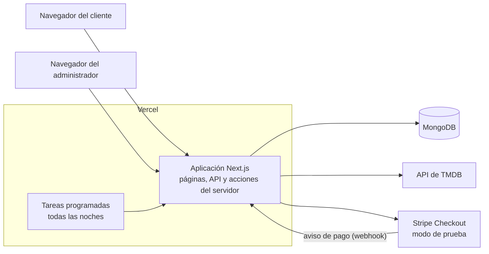

# 3. Arquitectura

## Vista general

MovieSeat es una sola aplicación de Next.js. La misma aplicación sirve las páginas, responde a la API y ejecuta las acciones del panel. Se publica en Vercel, guarda los datos en MongoDB y se conecta con dos servicios externos: TMDB para la información de las películas y Stripe para los pagos.

## Capas del código

| Carpeta | Qué contiene | Ejemplos |
|---|---|---|
| `app/` | Páginas, rutas de la API y componentes visuales | `app/(mainpages)/funcion/[id]`, `app/api/reservations` |
| `lib/` | La lógica más delicada del negocio | `lib/reservations.ts`, `lib/payments/checkout.ts`, `lib/schedule.ts` |
| `services/` | Acciones del servidor que usa el panel | `services/movies.ts`, `services/users.ts` |
| `models/` | Modelos de MongoDB con Mongoose | `models/Session.ts`, `models/Ticket.ts` |
| `schema/` | Reglas de validación con Zod | `schema/reservation.ts`, `schema/checkout.ts` |
| `types/`, `interfaces/` | Tipos y enumeraciones compartidas | `types/reservation.ts` |
| `utils/` | Funciones pequeñas de apoyo | `utils/showtime.ts`, `utils/format.ts` |
| `scripts/` | Comandos de apoyo | `scripts/demo.mjs`, `scripts/create-admin.mjs` |

Las rutas de `app/api` y las acciones de `services/` validan los datos con los esquemas de `schema/`, usan la lógica de `lib/` y guardan con los modelos de `models/`.

## Partes del sitio

| Grupo | Rutas | Quién entra |
|---|---|---|
| Sitio público | `/`, `/releases`, `/upcoming`, `/movie/[id]`, `/foods`, `/about` | Cualquier persona |
| Cuenta | `/login`, `/register` | Cualquier persona |
| Compra | `/funcion/[id]`, `/compra/[id]`, `/mis-boletas` | Clientes con sesión iniciada |
| Panel | `/dashboard/...` | Solo administradores |
| API | `/api/...` | Ver [API](07-api.md) |

`middleware.ts` revisa la sesión antes de abrir cualquier página del panel. Además, cada acción que crea, cambia o borra datos, y cada consulta de usuarios, ventas o transacciones, vuelve a comprobar en el servidor que quien la ejecuta es administrador. Las consultas del catálogo, como películas, salas y funciones, son públicas porque el sitio también las muestra.

## Decisiones de diseño

**Next.js con App Router.** Permite tener las páginas, la API y las acciones del servidor en un solo proyecto y en un solo lenguaje. Las páginas se generan en el servidor, así cargan rápido y los buscadores las pueden leer.

**MongoDB.** Los datos de una función incluyen el mapa de sillas como un objeto, por ejemplo `{ "A1": true, "A2": false }`. MongoDB permite cambiar varias sillas en una sola operación atómica. Así se resuelve el problema de dos personas que eligen la misma silla al mismo tiempo, sin bloquear tablas. El detalle está en [Flujo de compra](05-flujo-de-compra.md).

**Stripe Checkout en modo de prueba.** La página de pago la muestra Stripe, así los datos de la tarjeta nunca pasan por nuestro servidor. El proyecto rechaza cualquier llave que no sea de prueba, para que nadie haga un cobro real por accidente.

**Vercel sin procesos encendidos.** En Vercel no hay un servidor esperando todo el tiempo. Por eso:

- Las tareas diarias se ejecutan con los cron de Vercel, configurados en `vercel.json`.
- Las reservas vencidas no se liberan con un temporizador: se liberan la próxima vez que alguien consulta o intenta apartar sillas de esa función.
- Los límites de intentos de inicio de sesión se guardan en MongoDB y no en memoria, porque cada petición puede llegar a una instancia distinta.

**Hora de Colombia.** Las funciones se guardan con la hora local del cine marcada como UTC: una función de las 7:00 p. m. queda guardada como `19:00Z`. Así la hora que se muestra no cambia según la zona horaria de quien la vea. Para comparar con "ahora", el sistema resta 5 horas a la hora real (`utils/showtime.ts`). Las compras, en cambio, guardan la hora real, y las gráficas del panel las agrupan con la zona `America/Bogota`.

**Copia de los datos en la boleta.** Las funciones antiguas se borran después de un mes. Por eso cada boleta guarda una copia del título, el póster, la sala, la fecha y las sillas, y sigue mostrando lo que se compró aunque la función ya no exista.
