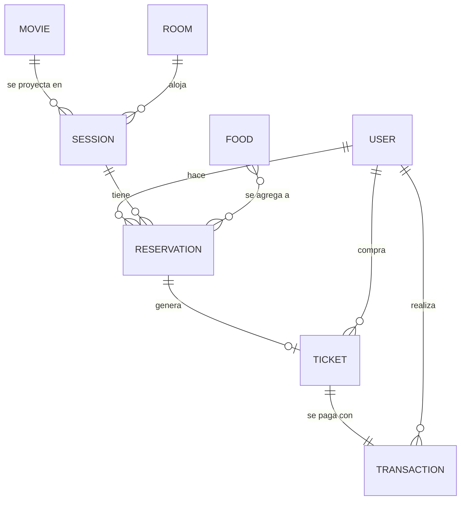
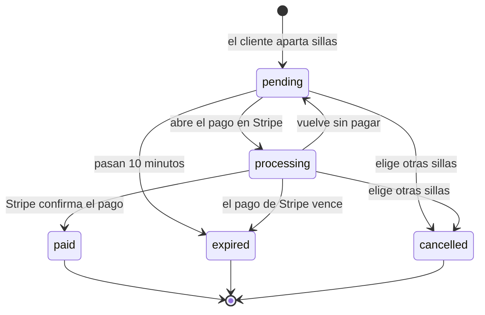

# 4. Modelo de datos

Los datos viven en MongoDB. Cada colección tiene su modelo en la carpeta `models/`.

## Relaciones

## Colecciones

### `movies` (películas)

| Campo | Tipo | Descripción |
|---|---|---|
| `imdb_id` | Número | Identificador de la película en TMDB. |
| `title`, `description` | Texto | Título y sinopsis en español. |
| `poster`, `backdrop` | Texto | Imagen vertical y fondo horizontal. |
| `releaseDate` | Fecha | Fecha de estreno en Colombia. |
| `duration` | Número | Duración en minutos. |
| `genre`, `cast`, `language` | Listas de texto | Géneros, reparto e idiomas. |
| `director`, `trailer` | Texto | Director y enlace del tráiler. |
| `status` | Texto | `billboard` (cartelera), `pre-sale` (preventa), `upcoming` (próximamente) o `archived` (archivada). |
| `popularity` | Número | Popularidad según TMDB. Ordena la cartelera cuando no hay lista. |
| `lastSeenInColombia` | Fecha | Última vez que TMDB la reportó en cartelera para Colombia. |
| `isManual` | Sí/No | `true` si la creó un administrador a mano. |
| `billboardPosition`, `billboardListedAt` | Número, fecha | Posición en la lista pegada por el administrador y cuándo se pegó. |

### `rooms` (salas)

| Campo | Tipo | Descripción |
|---|---|---|
| `name` | Texto | Nombre, por ejemplo "Sala 3". |
| `room` | Texto | Formato: `2D`, `3D` o `IMAX`. |
| `totalSeatsGeneral`, `totalSeatsPreferential` | Número | Sillas de cada tipo. Van en filas de 10, hasta 26 filas (A a Z). |
| `totalSeats` | Número | Total de sillas. |

### `sessions` (funciones)

| Campo | Tipo | Descripción |
|---|---|---|
| `movieId`, `roomId` | Referencia | Película y sala. |
| `dateTime` | Fecha | Fecha y hora de inicio, en hora de Colombia marcada como UTC. |
| `seatsGeneral`, `seatsPreferential` | Mapa | Cada silla y si está libre, por ejemplo `{ "A1": true, "A2": false }`. |
| `availableSeatsGeneral`, `availableSeatsPreferential`, `availableSeats` | Número | Sillas libres de cada tipo y en total. |
| `generalPrice`, `preferentialPrice` | Número | Precio de cada tipo de silla, en pesos. |

### `reservations` (reservas)

Una reserva es el paso entre elegir las sillas y pagar.

| Campo | Tipo | Descripción |
|---|---|---|
| `userId`, `sessionId` | Referencia | Quién reserva y para qué función. |
| `seats` | Lista | Sillas elegidas, cada una con su tipo (`general` o `preferential`) y su nombre (`A1`). |
| `seatsTotal` | Número | Valor de las sillas. |
| `foods` | Lista | Comida agregada, con nombre, cantidad y precio unitario guardados al momento de pagar. |
| `stripeSessionId` | Texto | Identificador del pago abierto en Stripe. |
| `status` | Texto | Estado de la reserva (ver abajo). |
| `expiresAt` | Fecha | Hasta cuándo se guardan las sillas. |

#### Estados de una reserva

Cuando una reserva pasa a `expired` o `cancelled`, las sillas vuelven a quedar libres y la comida vuelve al inventario.

### `tickets` (boletas)

| Campo | Tipo | Descripción |
|---|---|---|
| `code` | Texto | Código único, por ejemplo `MS-53A50353FB`. Es el contenido del QR. |
| `userId`, `sessionId`, `reservationId` | Referencia | Dueño, función y reserva de origen. `reservationId` es único: una reserva genera como máximo una boleta. |
| `movieTitle`, `moviePoster`, `roomName`, `roomFormat`, `dateTime` | Copia | Datos de la función guardados al momento de la compra. |
| `seats`, `foods` | Listas | Sillas y comida compradas. |
| `quantity`, `totalPrice` | Número | Cantidad de sillas y total pagado. |

### `transactions` (transacciones)

| Campo | Tipo | Descripción |
|---|---|---|
| `userId`, `ticketId` | Referencia | Quién pagó y qué boleta. |
| `foodItems` | Lista | Un elemento por cada unidad de comida. Lo usan las gráficas. |
| `totalAmount` | Número | Total pagado. |
| `paymentMethod` | Texto | `stripe`. |
| `paymentReference` | Texto | Identificador del pago en Stripe. Es único: un pago no se registra dos veces. |
| `status` | Texto | `completed`, `pending` o `cancelled`. |

### `users` (usuarios)

| Campo | Tipo | Descripción |
|---|---|---|
| `email` | Texto | Correo, único y en minúsculas. |
| `password` | Texto | Contraseña cifrada con bcrypt. |
| `name`, `lastName` | Texto | Nombre y apellido. |
| `role` | Texto | `client` o `admin`. |
| `tickets`, `transactions` | Listas | Boletas y transacciones del usuario. |

### `foods` (comida)

| Campo | Tipo | Descripción |
|---|---|---|
| `name`, `description`, `image` | Texto | Datos del producto. |
| `price` | Número | Precio en pesos. |
| `category` | Texto | `combos`, `foods` (comidas) o `drinks` (bebidas). |
| `type` | Texto | `popcorn`, `fast_food`, `bakery`, `drink` o `combo`. |
| `size` | Texto | `small`, `large` o `extralarge`. |
| `availableAmount` | Número | Unidades en inventario. |

### `ratelimits` (límites de intentos)

Guarda cuántos intentos de inicio de sesión o registro lleva cada correo o IP. Cada registro tiene una fecha de vencimiento, y MongoDB lo borra solo cuando vence.

## Índices importantes

| Colección | Índice | Para qué sirve |
|---|---|---|
| `reservations` | `status` + `expiresAt` | Encontrar rápido las reservas vencidas. |
| `reservations` | `userId` + `status` | Encontrar las reservas abiertas de un cliente. |
| `tickets` | `reservationId` (único) | Impedir dos boletas para la misma reserva. |
| `tickets` | `code` (único) | Impedir códigos repetidos. |
| `tickets` | `userId` + `dateTime` | Listar las boletas de un cliente. |
| `transactions` | `paymentReference` (único) | Impedir que un pago se registre dos veces. |
| `ratelimits` | `expiresAt` (TTL) | Borrar solos los contadores vencidos. |
