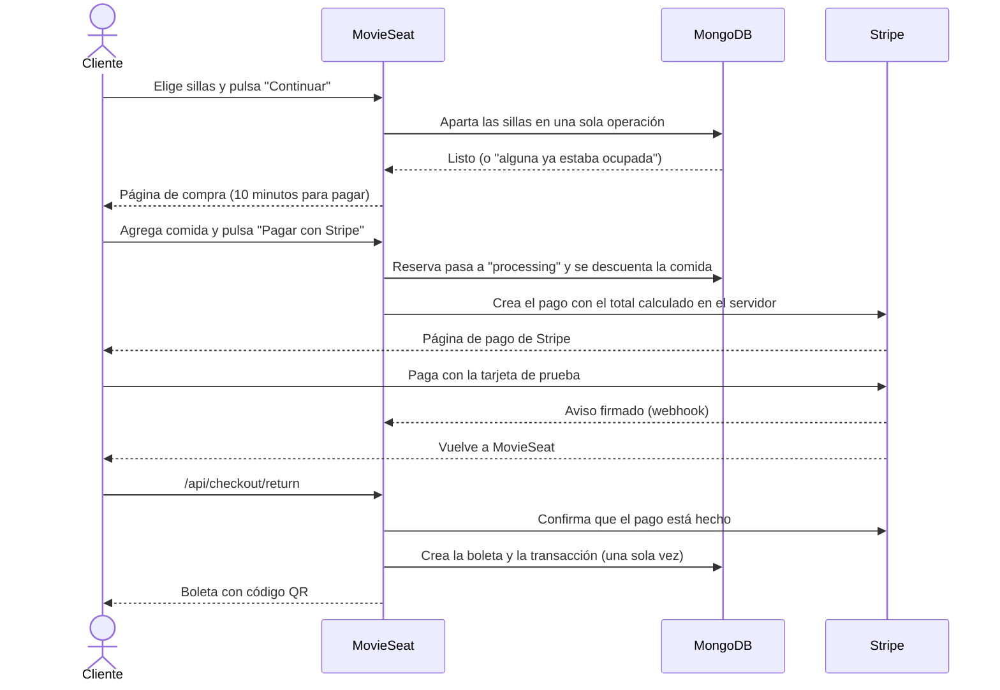

# 5. Flujo de compra

Esta es la parte más delicada del sistema: aquí se apartan sillas, se mueve el inventario de comida y se recibe el pago. Toda esta lógica está en `lib/reservations.ts`, `lib/payments/checkout.ts` y las rutas de `app/api/reservations`.

## Recorrido completo



## 1. Apartar sillas

Ruta: `POST /api/reservations`.

1. Se comprueba que haya una sesión iniciada y que la selección sea válida: entre 1 y 8 sillas, sin repetir y con nombres como `A1` o `C10`.
2. Se comprueba que la función exista y que no haya empezado.
3. Se liberan las reservas vencidas de esa función.
4. Si el cliente tenía otra reserva abierta, se cancela y sus sillas se liberan. Así una persona no acapara sillas en varias funciones.
5. Se apartan las sillas con **una sola operación atómica** sobre la función.
6. Se crea la reserva con estado `pending` y vencimiento en 10 minutos.

### Cómo se evita vender una silla dos veces

La operación del paso 5 pide a MongoDB: "cambia estas sillas a ocupadas, pero solo si todas siguen libres". En código se ve así:

```js
Session.updateOne(
  { _id: sessionId, "seatsGeneral.A6": true, "seatsGeneral.A7": true },
  { $set: { "seatsGeneral.A6": false, "seatsGeneral.A7": false },
    $inc: { availableSeatsGeneral: -2, availableSeats: -2 } },
);
```

MongoDB ejecuta cada actualización de un documento de forma atómica. Si dos personas piden la silla A6 al mismo tiempo, solo una actualización encuentra `A6: true`. La otra no modifica nada y el cliente recibe el aviso "Alguna de esas sillas ya no está disponible". Nunca queda una venta a medias: o se apartan todas las sillas elegidas o ninguna.

Lo comprobamos en la prueba P-22 de [Pruebas](12-pruebas.md#concurrencia). Ocho clientes pidieron la misma silla al mismo tiempo, en tres rondas. En cada ronda, solo uno la obtuvo.

## 2. Abrir el pago

Ruta: `POST /api/reservations/[id]/pay`.

1. La reserva pasa de `pending` a `processing` en una sola operación. Si el cliente pulsa "Pagar" dos veces, solo el primer clic abre un pago.
2. Se revisa que la función siga disponible.
3. Se descuenta la comida del inventario, producto por producto, solo si hay suficientes unidades. Si un producto no alcanza, se devuelve lo ya descontado y se avisa.
4. Se crea el pago en Stripe. **El total sale de los precios guardados en la base de datos**, nunca de lo que envía el navegador.
5. La reserva queda guardada por 36 minutos: Stripe exige que un pago dure al menos 30, y se suman unos minutos de margen para que la reserva no venza mientras alguien termina de pagar.

## 3. Recibir el pago

Hay dos caminos, y los dos llegan a la misma función, `completeCheckout`:

- **El cliente vuelve al sitio.** Stripe lo envía a `/api/checkout/return`. El sistema no confía en el dato de la dirección: le pregunta a Stripe si el pago está hecho.
- **Stripe avisa por su cuenta** con un webhook a `/api/webhooks/stripe`. La firma del aviso prueba que viene de Stripe. Este camino genera la boleta aunque el cliente cierre la pestaña justo después de pagar.

### Por qué un pago nunca genera dos boletas

Stripe puede avisar más de una vez, y además el cliente vuelve al sitio. Por eso cada paso revisa si ya se hizo:

- La boleta tiene un índice único por reserva. Si dos procesos intentan crearla al mismo tiempo, MongoDB rechaza la segunda, y el sistema usa la que ya existe.
- La transacción tiene un índice único por referencia de pago de Stripe, y se crea con una operación que solo inserta si no existe.
- Si la reserva ya está en `paid` y la boleta existe, simplemente se devuelve esa boleta.

## 4. Casos especiales

| Situación | Qué pasa |
|---|---|
| El cliente vuelve atrás desde Stripe sin pagar | El pago se cierra en Stripe, la comida vuelve al inventario y la reserva queda otra vez en `pending` por 10 minutos. |
| El cliente no paga a tiempo | La reserva vence. Las sillas y la comida se liberan la próxima vez que alguien consulte esa función, o cuando Stripe avisa que el pago venció. |
| El cliente elige otras sillas mientras tenía un pago abierto | El pago anterior se cierra y su reserva se cancela. |
| El pago se completó justo cuando se intentaba cerrar | Antes de liberar sillas, el sistema cierra el pago en Stripe y vuelve a revisarlo. Si alcanzó a pagarse, genera la boleta en lugar de liberar. |
| La función empieza mientras el cliente está comprando | No se puede abrir el pago y se muestra "Esta función ya no está disponible". |

## 5. La boleta

La boleta (`/mis-boletas/[id]`) muestra el póster, la película, la fecha, la hora, la sala, las sillas, la comida y el total pagado. Abajo aparece un código QR con el código de la boleta, por ejemplo `MS-53A50353FB`. El código se genera con 5 bytes aleatorios, así que es muy difícil de adivinar.

Solo el dueño de la boleta puede verla.
